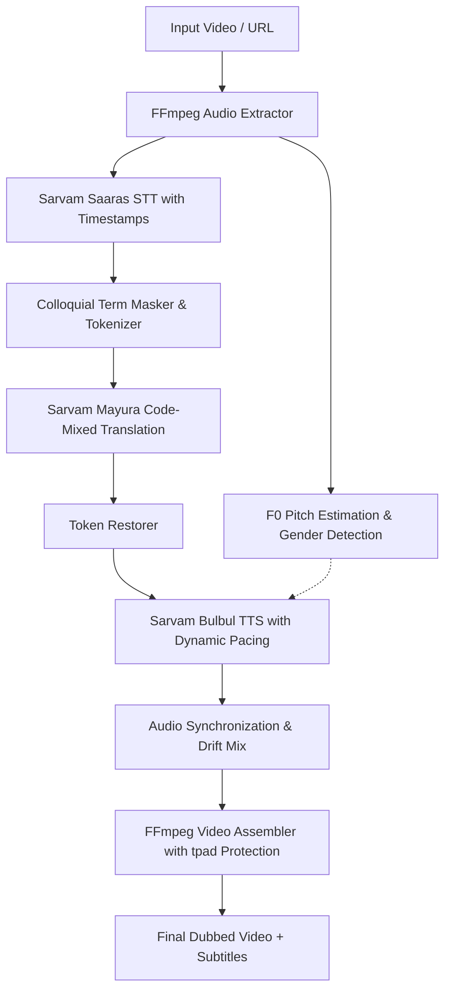

# Voicera 🎙️

🔗 **Live Demo:** [https://voicera-studio.onrender.com/](https://voicera-studio.onrender.com/)

**Voicera** is an automated video dubbing pipeline engineered specifically for Indian languages. It combines cloud speech intelligence, conversational translation, and audio-visual synchronization to produce natural-sounding dubbed videos without robotic pacing or artificial vocabulary.

---

## 🚀 Key Highlights & Engineering Features

* **🇮🇳 Full-Stack Indic Voice Pipeline (Sarvam AI)**:
  * **Speech-to-Text (`Saaras`)**: Accurate transcription tuned for diverse Indian accents, English, and code-mixed speech with chunk-level timestamps.
  * **Conversational Translation (`Mayura`)**: Uses modern `code-mixed` mode to preserve natural conversational grammar instead of stiff, archaic textbook translations.
  * **Expressive Neural Speech (`Bulbul`)**: Synthesizes human-like speech with authentic Indian cadences, inflections, and pacing.

* **⚡ Auto Voice Gender Detection ($F_0$ Pitch Estimation)**:
  * Automatically analyzes the original speaker's fundamental voice pitch ($F_0$) in milliseconds using autocorrelation (`scipy`/`numpy`).
  * Automatically matches male speakers to male voices and female speakers to female voices, with manual override support.

* **🎯 Natural Loanword Preservation (400+ Words)**:
  * Protects everyday colloquial English nouns (`school`, `phone`, `computer`, `office`, `bus`, `pen`, `doctor`, `exam`) using regex mask-and-restore tokens so sentences stay colloquial and relatable.

* **⏱️ Dynamic Sentence-Level Pacing**:
  * Dynamically calculates target speaking rates per sentence based on word count and video time slot, adapting Bulbul's synthesis speed natively rather than forcing robotic post-filter speedups.

* **🎬 Zero-Cutoff Video Assembler (`tpad`)**:
  * Intelligently detects if dubbed speech runs slightly longer than the original footage and automatically freezes/holds the final video frame (`ffmpeg tpad`) so not a single word is cut off.

---

## 📐 System Architecture



---

## 🌐 Supported Languages

* **Hindi** (`hi-IN`)
* **Telugu** (`te-IN`)
* **Tamil** (`ta-IN`)
* **Kannada** (`kn-IN`)
* **Malayalam** (`ml-IN`)
* **English** (`en-IN`)
* *(Extensible fallback for global languages via Microsoft Edge Neural TTS)*

---

## 🛠️ Tech Stack

* **Backend**: Python 3.9+, Flask, Threading, Gunicorn
* **AI & Speech Models**: Sarvam AI API (`saaras:v3`, `mayura:v1`, `bulbul:v3`)
* **Audio & Video Processing**: FFmpeg, FFprobe, NumPy, SciPy (Signal processing)
* **Frontend**: HTML5, CSS3 Glassmorphism, Vanilla JavaScript (Event-driven audio & real-time polling)

---

## 🏁 Quickstart

### Prerequisites
* **Python 3.9+**
* **FFmpeg** installed on your system:
  ```bash
  # macOS
  brew install ffmpeg

  # Ubuntu/Debian
  sudo apt update && sudo apt install ffmpeg
  ```

### 1. Clone the repository
```bash
git clone https://github.com/bhargavram-sec/Voicera.git
cd Voicera
```

### 2. Set up virtual environment
```bash
python3 -m venv .venv
source .venv/bin/activate
pip install -r requirements.txt
```

### 3. Configure environment variables
Create a `.env` file from `.env.example`:
```bash
cp .env.example .env
```
Add your Sarvam AI API key inside `.env`:
```env
SARVAM_API_KEY=your_sarvam_api_key_here
```

### 4. Run the Application
```bash
python app.py
```
Open your browser and navigate to: **`http://localhost:9090`**

---

## 📁 Project Structure

```text
Voicera/
├── app.py                      # Flask backend & job orchestration
├── processors/
│   ├── audio_extractor.py      # Audio extraction & F0 pitch gender detection
│   ├── transcriber.py          # Sarvam Saaras STT & SRT subtitle generation
│   ├── translator.py           # Sarvam Mayura translation (code-mixed)
│   ├── tts_generator.py        # Sarvam Bulbul TTS with adaptive pacing
│   ├── audio_sync.py           # Multi-segment audio alignment & delay mixing
│   └── video_assembler.py      # FFmpeg muxing & frame-hold protection
├── utils/
│   └── config.py               # Language configs & 400+ conversational loanwords
├── static/                     # CSS, client JS, demo audio assets
├── templates/                  # Frontend UI templates
├── uploads/                    # Temporary uploaded media files
├── outputs/                    # Completed dubbed videos & subtitles
├── .env.example                # Example environment file
└── requirements.txt            # Python dependencies
```

---

## 🛡️ License & Privacy
* Personal API keys and sensitive tokens are strictly isolated in local `.env` files and never tracked in source control.
